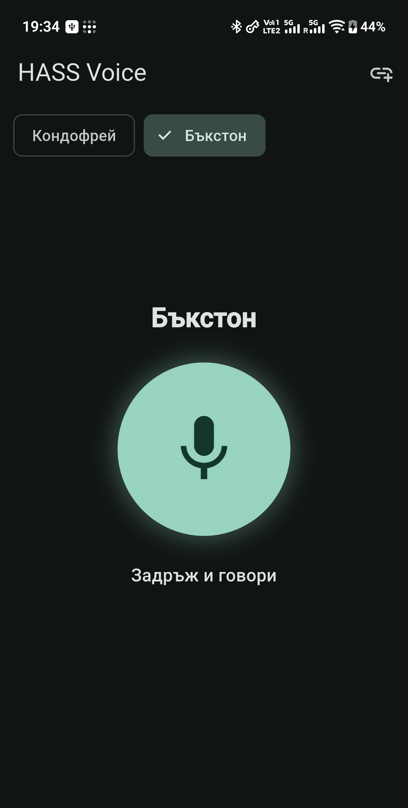
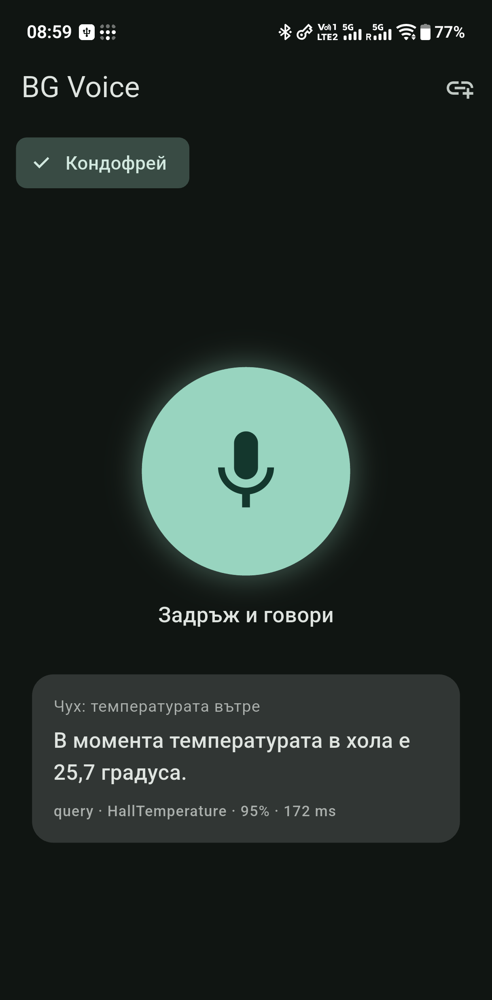

# BG Voice — Android push-to-talk client



A deliberately small Flutter Android app for
[`hass-bg-gateway`](https://github.com/kkazakov/hass-bg-gateway): hold the
microphone, speak Bulgarian, release. The gateway transcribes the audio, matches
one of its configured phrases, executes it against Home Assistant, and returns a
text reply. For questions marked `speak: true`, the app also plays the spoken
answer.

There is no wake word, no background listening, and no cloud service in the app
itself. It is a remote control for your own gateway.

## What it does

- **Push-to-talk**: press and hold the big mic button, release to send. A press
  shorter than 450 ms is discarded.
- **Multiple gateways**: keep one entry per Home Assistant/gateway, switch with
  a tap on the chip row at the top. The active entry is remembered across
  launches.
- **Add / edit / delete**: **＋** adds a gateway; long-press a chip to edit its
  URL/name/secret or delete it.
- **Optional gateway secret**: store the gateway's `BGV_API_KEY` per entry; the
  app sends it as `X-API-Key` for voice calls and reply-audio downloads. Leave
  it empty for a keyless gateway.
- **Text replies**: shows what was heard, the reply, the matched intent, score
  and latency.
- **Spoken queries**: when the gateway returns `audio_url` for a `speak: true`
  command, the app fetches and plays it (MP3 or WAV).
- **Bulgarian UI**, dark/light Material 3, no accounts and no telemetry.



## Requirements

1. A running [`hass-bg-gateway`](https://github.com/kkazakov/hass-bg-gateway)
   reachable from the phone. The default port is **8125**, e.g.
   `http://100.101.102.21:8125` (Tailscale) or `http://192.168.1.10:8125`
   (LAN). The gateway must listen on an interface the phone can reach
   (`--host 0.0.0.0`, or a Docker publish like `8125:8125`).
2. If the gateway sets `BGV_API_KEY`, have that value ready: the app sends it as
   `X-API-Key` on `/v1/voice` and on reply-audio downloads. Leave the secret
   empty for a keyless gateway.
3. The phone and gateway on the same network or VPN.
4. Android 8.0+ (`minSdk 26`). The app targets Android 15 (`targetSdk 35`,
   `compileSdk 36`).

The app does not care which commands exist: the catalogue lives in the
gateway's `config/commands.yaml` (or `BGV_COMMANDS_FILE`). Add the phrases there,
reload the gateway, and the app can use them immediately.

## Build and install

Flutter stable **3.47.x** (Dart 3.13) and Java **17–21**. Java 27 breaks the
current Android Gradle Plugin used by this project; use 21.

```bash
export JAVA_HOME=/usr/lib/jvm/java-21-openjdk
export PATH=$JAVA_HOME/bin:$PATH

flutter pub get
flutter analyze
flutter test                 # 18 tests, no device or gateway needed
flutter build apk --release  # ~50 MB, build/app/outputs/flutter-apk/app-release.apk
adb install -r build/app/outputs/flutter-apk/app-release.apk

# faster iteration, larger debug engine:
# flutter build apk --debug  # ~167 MB
```

The release build is signed with the **debug keystore** from the Flutter
template. That is fine for sideloading, not for Play Store distribution; add a
proper signing config before publishing.

If `adb` is not available, copy the APK to the phone and install it manually
(allow installation from unknown sources for the file manager/browser used).

## Using it

### Add a gateway

Tap **＋** (top right):

- **URL**: `100.101.102.21:8125`, `http://192.168.1.10:8125`, etc. If no scheme
  is given, `http://` is added. Trailing slashes are stripped.
- **Име (по избор)**: a label such as „Вкъщи“. If empty, the host is used.
- **Тайна (X-API-Key)** (optional): the gateway's `BGV_API_KEY`. Leave empty when
  the gateway has no key. The value is obscured by default; the eye button
  reveals it.

The new gateway becomes active immediately and is saved.

### Switch between gateways

The chips at the top are the saved gateways. Tap one to make it active. The
active id is stored in `SharedPreferences` and restored on the next launch. The
gateway URL is shown at the bottom while idle.

### Talk

Hold the centre button and speak, then release:

```
press → RECORD_AUDIO permission (first time) → record 16 kHz mono PCM16 WAV
release → POST multipart /v1/voice → show reply → play audio if speak == true
```

- Releasing before 450 ms shows „Задръж по-дълго“ and sends nothing.
- Dragging the finger off the button cancels the recording.
- While sending, the button shows a spinner and further presses are ignored.
- Temporary WAV files are deleted after send or cancel.

The result card shows the transcript (`Чух:`), the gateway's reply, the kind
(`action` / `query` / `no_match`), intent, score and total latency.

### Edit or delete a gateway

Long-press a chip:

- **Редактирай** — change the URL, name and/or secret. The saved secret is
  prefilled; clear the field to stop sending the header.
- **Изтрий** — asks for confirmation. If the active gateway is deleted, the
  first remaining one becomes active (or none).

Deleting a gateway does not uninstall the app or clear other entries.

## How it talks to the gateway

```
POST {gateway}/v1/voice
Content-Type: multipart/form-data
X-API-Key: <secret>            (only when the saved gateway has a secret)
field: audio = command.wav

{
  "kind": "action" | "query" | "no_match",
  "speak": false,
  "text": "Изключих лампата.",
  "transcript": "изключи лампата",
  "audio_url": null,
  "matched": {"intent": "LightOff", "score": 100.0, ...},
  "timings": {"asr_ms": 85.0, "ha_ms": 12.0, "tts_ms": 0.0, "total_ms": 120.0},
  "reason": null
}
```

When `speak` is true and `audio_url` is present, the app resolves it against the
gateway base URL, downloads it with the same `X-API-Key` header (same origin
only), and plays the bytes with `audioplayers` (Android MediaPlayer). The gateway
may return MP3 (gTTS) or WAV (Piper); both are supported. Audio is cached by the
gateway in memory, so a stale `audio_url` can return `404` after a gateway
restart.

`timings` is shown on the result card. `reason` explains a `no_match` in the
gateway logs; the card shows the gateway's reply text.

### Authentication

The gateway's key is optional and per saved gateway. When the **Тайна
(X-API-Key)** field is non-empty, the app sends `X-API-Key` on its gateway
requests: the `/v1/voice` upload and the same-origin `/v1/audio/...` download.
An empty field sends no header, so keyless gateways keep working. The secret is
not attached to an absolute `audio_url` that points at another host.

A `401` means the gateway has `BGV_API_KEY` set and the saved secret is missing
or different. Long-press the gateway chip → **Редактирай** and paste the exact
value, or clear `BGV_API_KEY` on the gateway. The app does not call `/v1/health`
or any other endpoint.

### One gateway = one Home Assistant

The gateway is bound to a single HA instance. If you have two homes, save two
gateway URLs as separate chips; each gateway has its own HA, token and command
catalogue. The app itself has no notion of instances.

## Permissions and networking

- `RECORD_AUDIO` — requested on the first hold.
- `INTERNET` — uploads the WAV and downloads reply audio.
- Cleartext HTTP is enabled (`android:usesCleartextTraffic="true"`) because home
  gateways are usually plain HTTP on a LAN/Tailscale. HTTPS with a public
  certificate works too, but there is no custom-CA/pinning support.
- No foreground service, no background recording, no notifications.

## Configuration and state

Everything is local to the app:

| Storage | Keys | Contents |
|---|---|---|
| `SharedPreferences` | `gateways_v1` | JSON list of `{id, name, url, secret}` (`secret` omitted when empty) |
| `SharedPreferences` | `active_gateway_v1` | id of the selected gateway |

The optional gateway secret is stored in the app's private `SharedPreferences`
in plaintext (Android app sandbox, not hardware-backed encryption). It is the
gateway's shared API key, not the Home Assistant token. There are no accounts or
analytics in the app. Uninstalling the app removes the gateway list; the HA
token and command catalogue live on the gateway, not on the phone.

## Development

```
lib/
  main.dart      HomePage, gateway strip, mic button, result card, dialogs
  models.dart    Gateway (URL normalisation, optional secret), CommandResult
  store.dart     SharedPreferences persistence
  api.dart       multipart upload, optional X-API-Key, audio download, errors
  recorder.dart  `record` wrapper (16 kHz mono WAV)
test/            model/store/API tests + widget flows (add/edit/delete)
android/         manifest (mic, internet, cleartext), minSdk 26, targetSdk 35
docs/            screenshots
```

Useful commands:

```bash
flutter analyze
flutter test
flutter run -d <device-id>       # debug on a connected device
adb logcat | grep -iE "flutter|audioplayers|bg.krasi"
```

The widget tests use `SharedPreferences.setMockInitialValues({})`; they never
touch a real gateway or microphone.

## Troubleshooting

| Symptom | Likely cause / fix |
|---|---|
| `Няма връзка с http://…` | Gateway not reachable, wrong IP/port, firewall, or it listens on loopback only. Default port is **8125**; check `curl http://<host>:8125/v1/health`. |
| `Gateway изисква валидна тайна (X-API-Key)` | The gateway has `BGV_API_KEY` set but the saved secret is missing or wrong. Long-press → Редактирай and paste the exact key, or clear `BGV_API_KEY` on the gateway. |
| `Gateway не отговаря (timeout)` | Gateway host down, phone VPN off, or slow first ASR load. |
| „Не разбрах. Повторете, моля.“ | The gateway heard you but no phrase matched. Add the phrase/hotwords to its catalogue; check `/v1/commands`. |
| Result appears but no sound | Media volume/route, or audio playback failed silently. Check volume and the gateway's `GET /v1/audio/...`; the app fetches MP3/WAV. |
| „Няма разрешение за микрофон“ | Grant Microphone permission in Android settings. |
| Button does nothing | Press was shorter than 450 ms, or the app is still sending (spinner). |
| APK won't install | Android < 8.0, or the package/signature conflicts with another install. |
| Gateway URL footer shows an old port | Edit the chip URL (long-press → Редактирай); the app does not migrate saved URLs. |

The gateway side has its own README, including Docker, HTTPS, API key and
command-catalogue instructions:
<https://github.com/kkazakov/hass-bg-gateway>.

## Known limits

- One optional shared key (`BGV_API_KEY`) per gateway; no per-user keys or
  in-app rotation.
- The secret is stored in app-private `SharedPreferences`, not encrypted at
  rest.
- HTTP/HTTPS only, no custom CA or certificate pinning.
- Push-to-talk only; no wake word, streaming partials or background listening.
- One active gateway per request; no per-command routing between gateways.
- No in-app command list; commands are edited on the gateway.
- UI is Bulgarian only.
- Release APK is debug-signed and not Play-Store ready.

## Security notes

- The gateway URL and optional gateway secret, not the HA token, are stored on
  the phone. The HA token stays on the gateway.
- The gateway secret is kept in app-private `SharedPreferences` in plaintext.
  Use a dedicated key, not a reused password, and prefer HTTPS/VPN transport.
  Android Auto Backup may include app preferences; exclude the app from backup
  if the key must not leave the device.
- Audio is sent only to the configured gateway. If the gateway's TTS provider is
  `gtts`, the *answer text* of spoken queries is sent to Google by the gateway;
  `piper` keeps it local.
- Prefer Tailscale/LAN or a VPN. If you expose the gateway publicly, terminate
  HTTPS at a reverse proxy, set an API key, and enter that key in the gateway
  entry (long-press → Редактирай).
- The app allows cleartext traffic by design; do not use it over untrusted
  networks.
